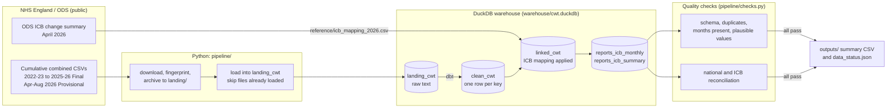

# NHS Cancer Waiting Times pipeline

A repeatable pipeline that downloads NHS England Cancer Waiting Times (CWT) data, tidies it, checks it automatically, and produces a summary table anyone can read. It handles the change to NHS integrated care boards (ICBs) on 1 April 2026.

It is built as a portfolio project, using an agentic AI workflow (see `docs/agent-workflow.md`, once written).

## What you get

- **`outputs/summary_icb_last_4_months.csv`**: the four most recent months, by ICB, for each of the three headline waiting-time standards.
- **`outputs/data_status.json`**: when the data was last downloaded, the newest month, and how many months are still provisional.
- **Quality checks** that stop the run before a bad load reaches the summary.

## Quick start

You need Python 3.11 or newer, and about 1 GB of free disk space for the raw files.

```bash
python -m pip install duckdb dbt-core dbt-duckdb pyyaml requests pytest black
python -m pipeline                 # download, build, check, publish
python -m pytest                   # run the tests
```

To look at the results in a browser (this reads only the small files in `outputs/`):

```bash
python -m pip install streamlit pandas
python -m streamlit run dashboard/app.py
```

To rebuild every table from scratch (for example after a change to a table definition):

```bash
python -m pipeline --full-refresh
```

Running the pipeline again with no new files changes nothing. Files that have already been loaded are skipped, and only months that arrived in a newer load are rebuilt.

## How it works



The run has four steps, and it stops at the first failure:

1. **Ingest:** download each file listed in `config/sources.yml`, archive it, and load it. Files already loaded are skipped.
2. **Build:** dbt tidies the data, applies the ICB mapping, and builds the report tables. dbt's own tests run here.
3. **Check:** the Python quality checks run.
4. **Publish:** the summary CSV and status file are written.

### Folder layout

| Folder or file | What it holds |
|---|---|
| `config/sources.yml` | The NHS files to load, with their status (final or provisional). Change this to add a newer month. |
| `reference/icb_mapping_2026.csv` | Which ICB replaced which on 1 April 2026, and where it came from. |
| `pipeline/` | The Python steps: download, load, checks, and the run order. |
| `dbt/` | The SQL models that tidy and report the data, and dbt's tests. |
| `tests/` | Automated tests for the checks and the ingest rules. |
| `landing/` | Downloaded NHS files, one folder per pull date. Not committed. |
| `warehouse/` | The DuckDB database. Not committed; rebuilt by the pipeline. |
| `outputs/` | The summary table and status file. |
| `docs/` | `decisions.md` (why things are done this way) and `data_dictionary.md` (what each column means). |

## Data sources

All data is published by NHS England on the Cancer Waiting Times statistics page:
https://www.england.nhs.uk/statistics/statistical-work-areas/cancer-waiting-times/

The ICB changes come from the NHS England Organisation Data Service (ODS):
https://digital.nhs.uk/services/organisation-data-service/upcoming-code-changes/icb-mergers-2026-change-summary

Data is published under the NHS England terms of use. Check the licence shown on the source page before reusing the data elsewhere.

## Glossary

| Term | Plain English |
|---|---|
| **Cancer Waiting Times (CWT)** | NHS England's monthly record of how quickly people with suspected cancer are seen and treated. |
| **ICB (integrated care board)** | An organisation that plans and pays for NHS services across a region. Twelve were merged into six on 1 April 2026. |
| **Commissioner** | An organisation that buys NHS services. In this data, ICBs and commissioning hubs are commissioners. |
| **Commissioning hub** | A national NHS team that commissions specialist services. Not a geographic area, so it is left out of ICB tables. |
| **Provider** | An organisation that delivers NHS care, such as a hospital trust. |
| **62-day standard (62D)** | Most patients should start cancer treatment within 62 days of an urgent referral. |
| **31-day standard (31D)** | Most patients should start first treatment within 31 days of a decision to treat. |
| **Faster Diagnosis Standard (FDS)** | Most patients with suspected cancer should be diagnosed, or have cancer ruled out, within 28 days. |
| **Performance** | The share of patients treated within the standard's time limit. Calculated as `within ÷ total`. |
| **Provisional** | The first published figures for a month. They can still change. |
| **Final** | Figures NHS England has finalised. Preferred when available. |
| **Restatement** | NHS changing the published figures for a month that has already been published with the same status. The pipeline stops and asks for a check. |
| **Landing** | The first place the downloaded data goes, kept exactly as published. |
| **Clean (dbt layer)** | The tidy version of the data: proper dates and numbers, consistent names, one row per key. |
| **Linked (dbt layer)** | The clean data joined to the ICB mapping. |
| **Reports (dbt layer)** | The final tables people read. |
| **Natural key** | The set of columns that together identify one row: month, organisation, standard, cancer type, route and treatment. |
| **Upsert / merge** | Update a row if its key already exists, otherwise insert it. Used so re-runs do not create duplicates. |
| **dbt (data build tool)** | A tool that runs SQL transformations in a fixed order and tests the results. |
| **DuckDB** | A small database that runs on a laptop. Used here instead of a cloud warehouse, so the project costs nothing to run. |
| **Manifest** | A list recording each download: where it came from, its size, and its fingerprint. Saved in each `landing/` folder. |
| **SHA-256** | A fingerprint of a file. Change one byte and the fingerprint changes, so the pipeline can tell whether a file is new. |
| **Incremental build** | Rebuilding only the months that have changed, rather than the whole history. |
| **Reconciliation** | Checking that two totals that should match, do. Here: the national total against the sum of all commissioners, and the ICB report against the commissioner total. |

## Limitations

- **Frimley ICB is left out of ICB tables.** It closed on 31 March 2026 and was split between three ICBs. The NHS does not give a way to divide its earlier history between them, so we did not guess. It is still included in national totals, so those still match NHS England.
- **Hampshire and Isle of Wight changed its boundary** on 1 April 2026. Its history before that date covers a smaller area, so trends across that date are not like-for-like.
- **The latest months are provisional.** Figures for April to August 2026 may be revised.
- **2021-22 is not included.** The NHS does not publish it as a combined CSV in the same format.
- **Standards before October 2023** for 31-day and 62-day are not directly comparable with later figures, because the NHS changed the standards then. Check this before comparing older years.

## Decisions

Every choice that affects the numbers, with its evidence, is in [`docs/decisions.md`](docs/decisions.md).

## Licence and attribution

Source data: NHS England, Cancer Waiting Times. Mapping: NHS England Organisation Data Service. Check the licence on each source page before reuse.
